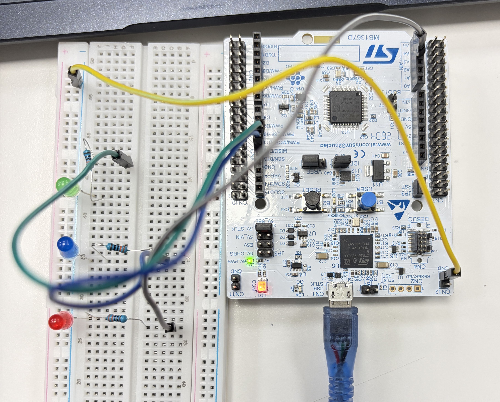
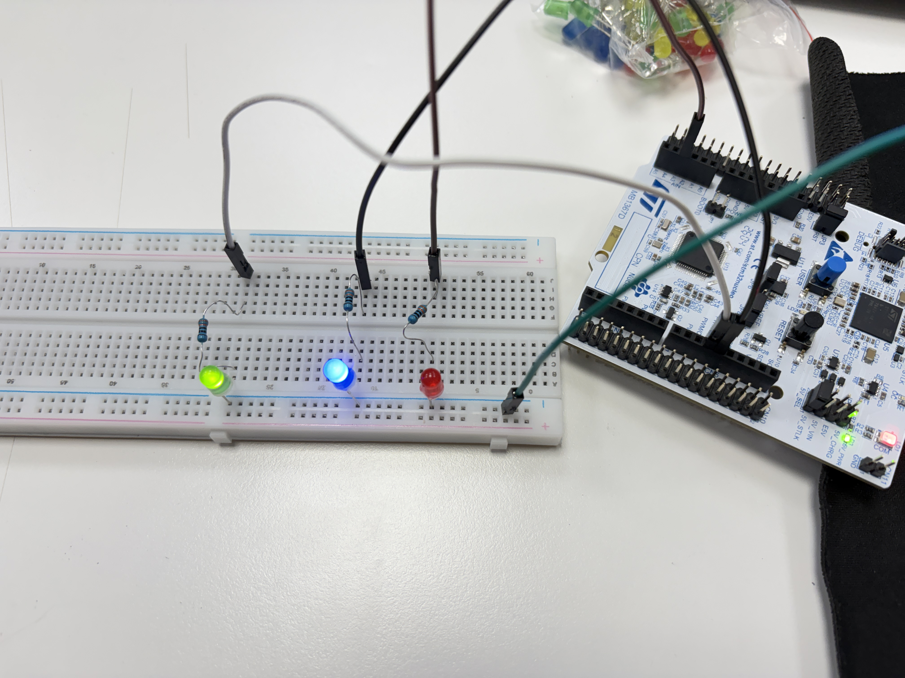

# 太空艙最後三分鐘

使用 NUCLEO-G474RE 與 Python 控制面板，模擬太空艙緊急維修。

## 1. 情境故事

曙光號太空艙供電失效，操作員必須在 180 秒內接通備援，將核心輸出設定為 60%，連續維持 5 秒後按下實體 B1，完成重啟。

## 2. 替身對照

| 故事設備 | 實作替身 |
|---|---|
| 備援電源 | 綠色 LED／GPIO |
| 核心輸出 | 藍色 LED／PWM |
| 警報裝置 | 紅色 LED／GPIO |
| 重啟開關 | 板上 B1 |
| 控制面板 | Python tkinter＋pyserial |

## 3. 功能與驗收條件

| 測試動作 | 預期結果 | 驗收紀錄 |
|---|---|---|
| 備援接通、60% 滿 5 秒後按 B1 | 重啟成功，停止倒數 | 已有 SUCCESS 截圖 |
| 未接備援就設定輸出 | 拒絕設定 | 通過 |
| 未滿 5 秒按 B1 | 提示等待，任務繼續 | 通過|
| POWER 60 → 59 → 60 | 穩定時間重新累計 | 通過 |
| 180 秒內未完成 | FAILED，剩餘時間歸零 | 通過 |

## 4. 使用技術

- [x] GPIO 輸出：PA7 備援燈、PB0 警報燈。
- [x] GPIO 輸入：PC13 實體 B1。
- [x] 複用功能 AF：USART2 使用 AF7，TIM3_CH1 使用 AF2。
- [x] PLL：HSI16 ÷ 4 × 85 ÷ 2，系統時脈 170 MHz。
- [x] EXTI：PC13 上升緣記錄按鍵事件。
- [x] NVIC 致能：TIM2、USART2、EXTI15_10。
- [ ] 優先權與巢狀：未驗證巢狀中斷。
- [x] 軟體去彈跳：按鍵間隔至少 50 ms。
- [x] UART 傳送：回報狀態與事件。
- [x] UART 接收＋環形緩衝：中斷收字，主迴圈解析。
- [x] Timer 定時中斷：TIM2 每 1 ms 更新時間。
- [x] PWM：TIM3_CH1 輸出 1 kHz，模擬核心亮度。
- [ ] 輸入捕捉：未使用。

## 5. 腳位表

| 腳位 | 用途 |
|---|---|
| PA7／D11 | 備援綠燈 |
| PB0／A3 | 警報紅燈 |
| PA6／D12 | 核心藍燈，TIM3_CH1 PWM |
| PC13 | 板上 B1，EXTI13 |
| PA2／PA3 | USART2 TX／RX，經 ST-LINK 虛擬 COM 通訊 |

每顆外接 LED 串接 330 Ω 電阻，負極接共同 GND。

## 6. 建置與執行

環境：STM32CubeIDE 2.2.0、Python 3.13.15、pyserial 3.5。

1. 使用 STM32CubeIDE 匯入專案，Build 後透過 ST-LINK 燒錄。
2. 安裝套件並啟動控制面板：

```bash
python -m pip install pyserial==3.5
python space_capsule_panel.py
```

3. 選擇 ST-LINK COM 埠，本機為 COM6；通訊設定為 **115200、8N1**。
4. 依序執行 `START` → `BACKUP ON` → `POWER 60`，等待至少 5 秒，再按板上 B1。

其他指令：`STATUS` 查詢狀態；成功或失敗後使用 `RESET` 回到待命。任務進行中拒絕重新啟動或重設。

## 7. 程式結構

原始碼與 Python 檔案待上傳。

| 檔案 | 用途 |
|---|---|
| `SpaceCapsule.ioc` | CubeMX 腳位、時脈與周邊設定 |
| `Core/Src/main.c` | 狀態機、指令解析、計時與燈號控制 |
| `Core/Src/stm32g4xx_it.c` | 中斷入口 |
| `Core/Src/stm32g4xx_hal_msp.c` | 周邊腳位與 NVIC 初始化 |
| `space_capsule_panel.py` | Python 操作面板與序列通訊 |

中斷負責更新時間、接收字元與記錄按鍵；主迴圈負責解析指令及判斷結果。Python 顯示 STM32 回報，不自行決定成敗。

## 8. 實作照片

以下圖片待上傳至 `docs/`，檔名須與連結一致。

接線總覽：開發板、麵包板與三顆外接 LED。



燈號紀錄：綠燈與核心藍燈發光。



重啟成功：通訊紀錄出現 `EVENT RESTART_SUCCESS` 與 `state=SUCCESS`。


## 9. AI 使用說明

使用 ChatGPT 協助功能規畫、STM32 狀態機與 UART／計時／PWM 程式、Python 面板、除錯及文件整理。

本人負責環境設定、實體接線、燒錄與操作，並透過 `STATUS`、`EVENT` 回報及實機燈號查核結果。

## 10. 已知限制

- LED 模擬設備；60% 為 PWM 設定值，未量測真實功率。
- 精準計時誤差、期限邊界與斷線重連仍待驗證。
- 失敗及例外案例的通訊截圖仍待補齊。
